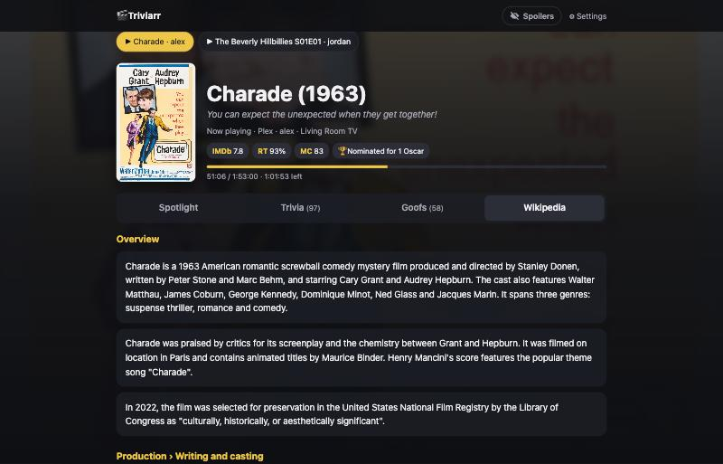
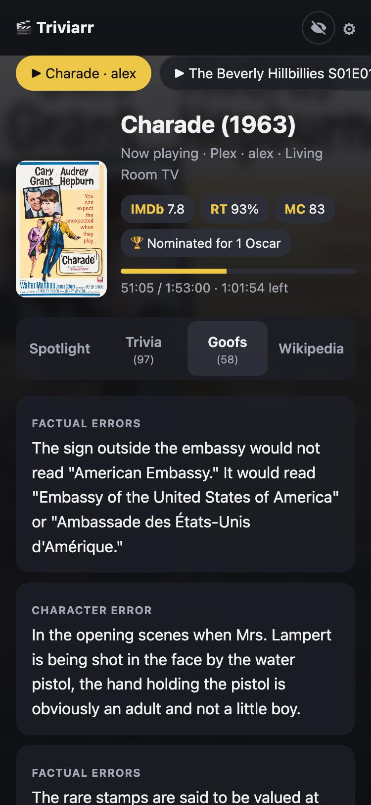
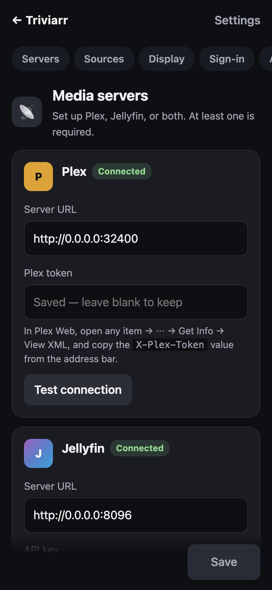

# 🎬 Triviarr

Trivia for whatever you're watching. Triviarr checks what's playing on **Plex** or **Jellyfin** and shows trivia, goofs and background about that movie or TV episode from **IMDb**, **Wikipedia** and, optionally, **OMDb**. It runs in Docker on Unraid, QNAP or any Docker host, and the page works on phones, tablets and computers.

<p align="center">
  
  
  
</p>
<p align="center">
  
</p>
<p align="center">
  
  
  
</p>
<p align="center"><sub>Screenshots use demo data: public-domain titles, made-up users.</sub></p>

## Features

- **Spotlight**: one fact at a time. Tap the card or use ← → to skip. The circular-arrows button turns auto-advance on (a new fact every 20 seconds) or off.
- **Trivia** and **Goofs**: the full IMDb lists. Spoilers stay blurred until you tap them, or tap the eye button in the header to show them all.
- **Wikipedia**: production, release, reception and legacy sections. Plot sections are always skipped.
- **TV shows**: facts about the episode on screen come first, then the series. Each item is labelled *This episode* or *Series*.
- **Ratings & awards** (optional, free OMDb key): IMDb, Rotten Tomatoes and Metacritic scores, awards and box office under the title, plus OMDb facts in Spotlight.
- **Choose your sources** in Settings: switch each source on or off, pick Wikipedia sections and kinds of goofs, and choose episode and/or series facts for TV.
- **Several things playing?** Buttons at the top switch between them. Nothing playing? Look up any movie by name.
- **Optional sign-in** with Plex or Pocket ID (or any OpenID Connect provider).

## Install

Triviarr is a single container. The image `ghcr.io/infestacool/triviarr:latest` is built for **x86-64** and **64-bit ARM**.

| Setting | Value |
|---|---|
| Port | Container port **8080** (map it to any free port, e.g. 8085) |
| Volume | **/config**, where settings are saved |
| PUID / PGID | Optional, default `99` / `100`. The user and group that own `/config`. |

Everything else is set up on the **Settings** page after it starts.

### Unraid

1. In the Unraid terminal, download the template:
   ```bash
   wget -O /boot/config/plugins/dockerMan/templates-user/my-triviarr.xml https://raw.githubusercontent.com/infestacool/triviarr/main/unraid/triviarr.xml
   ```
2. Go to **Docker → Add Container**, choose **triviarr** from the *Template* list, and click **Apply**.
3. Open `http://<server-ip>:8085` and click **⚙** to open Settings.

Settings are saved in `/mnt/user/appdata/triviarr`. To update, click **Check for Updates** in the Docker tab.

### Docker / Docker Compose

```bash
docker run -d --name triviarr --restart unless-stopped -p 8085:8080 -v /path/to/triviarr:/config ghcr.io/infestacool/triviarr:latest
```

Or with Compose, using the [`docker-compose.yml`](docker-compose.yml) in this repo:

```yaml
services:
  triviarr:
    image: ghcr.io/infestacool/triviarr:latest
    container_name: triviarr
    restart: unless-stopped
    ports:
      - "8085:8080"
    volumes:
      - ./config:/config
    environment:
      - PUID=1000   # optional: run `id` on the host to find yours
      - PGID=1000
```

To update: `docker compose pull && docker compose up -d`.

### QNAP (Container Station)

1. In **File Station**, create a folder for the settings, e.g. `/share/Container/triviarr`.
2. Open **Container Station → Applications → Create**, name it `triviarr`, and paste:
   ```yaml
   services:
     triviarr:
       image: ghcr.io/infestacool/triviarr:latest
       container_name: triviarr
       restart: unless-stopped
       ports:
         - "8085:8080"
       volumes:
         - /share/Container/triviarr:/config
   ```
3. Click **Validate**, then **Create**.
4. Open `http://<nas-ip>:8085` and click **⚙** to open Settings.

To update, open the application in Container Station and choose **Recreate** with *pull the latest image* ticked. This works on x86-64 and 64-bit ARM QNAPs; older 32-bit ARM models aren't supported.

### Synology and others

Any Docker host works the same way: run the image with port 8080 and a `/config` volume. On Synology, use **Container Manager → Project** and the Compose file above.

## Settings

| Section | What it does |
|---|---|
| **Media servers** | Plex (URL + token) and/or Jellyfin (URL + API key). At least one is required. **Test connection** checks each one. |
| **Sources** | Switch IMDb trivia, IMDb goofs, Wikipedia and Ratings & awards on or off. Pick Wikipedia sections and kinds of goofs, and for TV whether to show episode facts, series facts or both. |
| **Display** | Only show what certain people are watching, e.g. so you don't see what the kids are watching in another room. |
| **Sign-in** | Off by default. See below. |
| **Advanced** | HTTPS certificate checks, and a public URL for reverse proxies. |

**Finding your keys**

- **Plex token**: in Plex Web, open any item, then ⋯ → *Get Info* → *View XML*. Copy the `X-Plex-Token=` value from the address bar.
- **Jellyfin API key**: *Dashboard → API Keys → +*.
- **OMDb key** (optional): free at [omdbapi.com](https://www.omdbapi.com/apikey.aspx), 1,000 lookups a day. Activate it from the email they send, paste it into the *Ratings & awards* card, and click **Test key**. Each title is looked up at most once a day, so the free limit is plenty.

Server URLs look like `http://0.0.0.0:32400` (Plex) or `http://0.0.0.0:8096` (Jellyfin), using your server's address. Don't use `localhost`: inside the container that means the container itself.

## Sign-in (optional)

Sign-in is **off by default**, so anyone on your network can open the page. To require it, choose an option under **Settings → Sign-in**:

- **Sign in with Plex**: anyone who has access to your Plex server can sign in. The server owner can open Settings. You can also add extra users with *Allowed users* and choose who can change settings with *Admins*.
- **Sign in with Pocket ID** (or any OpenID Connect provider, such as Authelia, Authentik or Keycloak):
  1. In Pocket ID, go to *Administration → OIDC Clients → Add OIDC Client*.
  2. Set the callback URL to the one shown on the Settings page (`http://<server-ip>:8085/auth/oidc/callback`).
  3. Paste the issuer URL (e.g. `https://id.example.com`), client ID and client secret into Triviarr.
  4. To control who gets in, either restrict the client to user groups in Pocket ID, or list emails, usernames or groups under *Allowed users*.

After you save, you'll be asked to sign in right away.

**Locked out?** Set the container variable `AUTH_DISABLE=true`, restart, fix the settings, then remove it. (On Unraid it's under *Show more settings* in the template.)

## Environment variables

All optional. Anything saved on the Settings page takes precedence.

| Variable | Default | Meaning |
|---|---|---|
| `PUID`, `PGID` | `99`, `100` | User and group that own `/config` and run the app |
| `PLEX_URL`, `PLEX_TOKEN` | | Plex server, if you'd rather not use the Settings page |
| `JELLYFIN_URL`, `JELLYFIN_API_KEY` | | Jellyfin server |
| `OMDB_API_KEY` | | OMDb key for ratings & awards |
| `AUTH_DISABLE` | `false` | `true` skips sign-in, to recover from a lock-out |
| `CACHE_HOURS` | `24` | How long trivia is kept before it's fetched again |

## Notes

- Titles are matched to Wikipedia through Wikidata using the IMDb or TMDb ID from your media server, so remakes and films with the same title are matched correctly.
- IMDb data comes from the feed IMDb's own website uses. IMDb allows only limited personal, non-commercial use of its data, which a home server meets.
- Every push to `main` builds a new image with GitHub Actions. Each build is started and checked before it's published.

## Run locally for development

```bash
python3 -m venv .venv && .venv/bin/pip install -r requirements.txt
```
```bash
CONFIG_DIR=./config .venv/bin/uvicorn app.main:app --reload --port 8085
```
