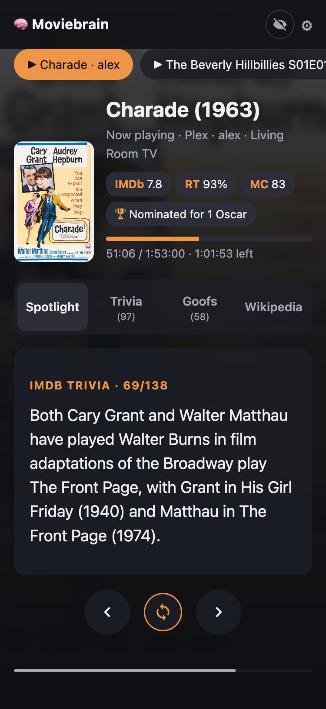
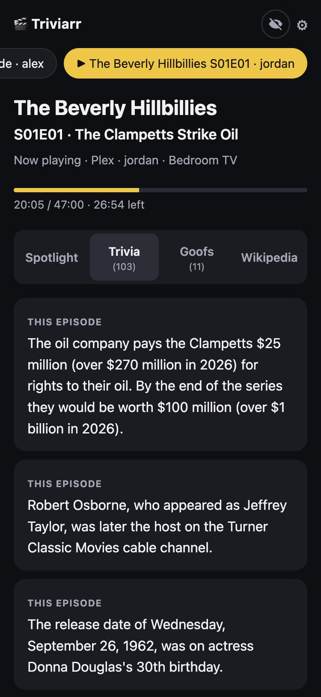
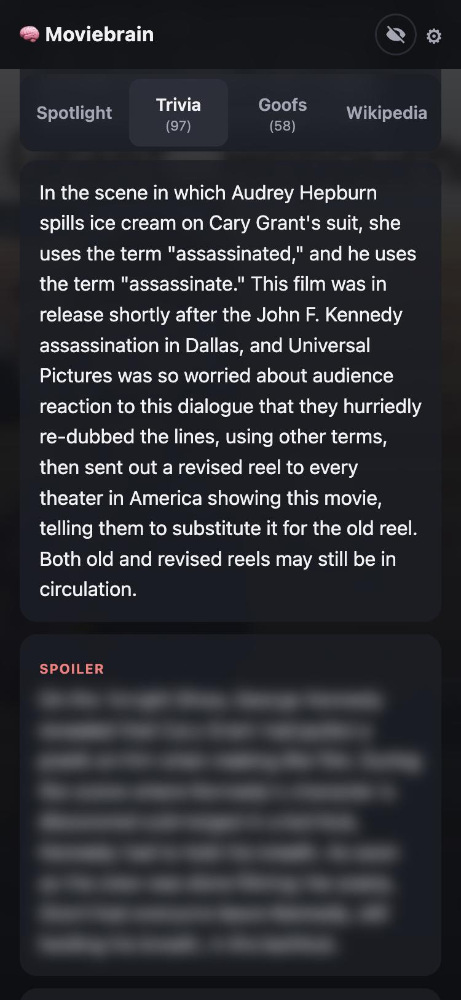
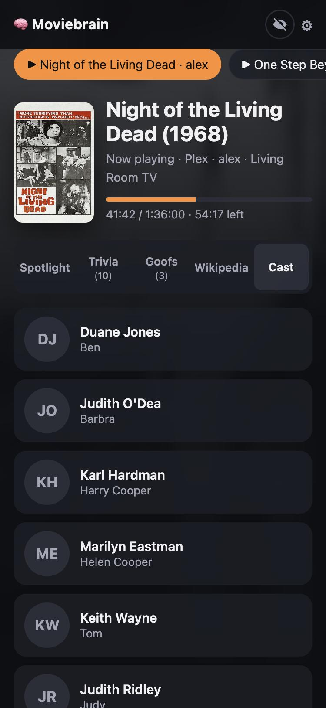
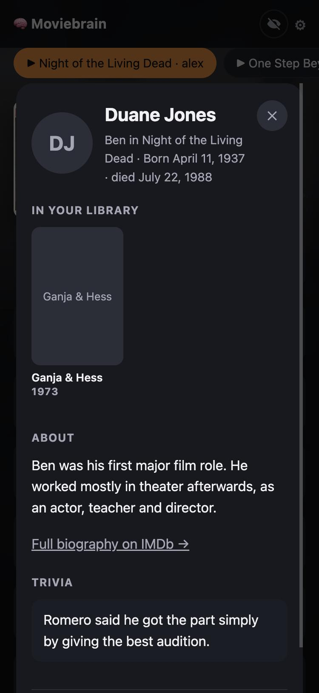
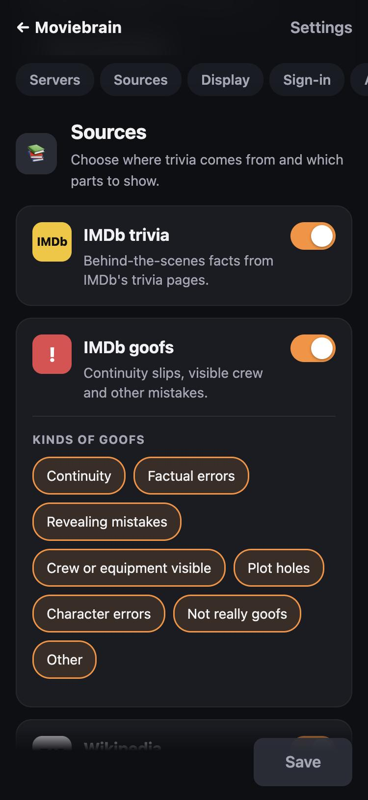

# 🧠 Moviebrain

**[Try the demo →](https://infestacool.github.io/moviebrain/)** (sample data, no install)

Trivia for whatever's playing on **Plex** or **Jellyfin**: IMDb trivia and goofs, Wikipedia background, cast, and optional OMDb ratings. A small self-hosted web app for phones, tablets and desktops. Runs in Docker on Unraid, QNAP, Synology or any Docker host.

<p align="center">
  
  
  
</p>
<p align="center">
  
  
  
</p>
<p align="center"><sub>Screenshots: public-domain film and poster, made-up users, placeholder fact text.</sub></p>

## Features

- **Spotlight**: one fact at a time, optional auto-advance.
- **Second screen**: full-screen, hands-free facts for a tablet or old phone by the TV. It keeps the screen awake, follows what's playing, and opens directly from `http://<server>:8085/?screen` (bookmark it or add it to your home screen).
- **Trivia, Goofs, Wikipedia**: full lists; spoilers blurred until tapped; plots skipped.
- **Cast**: tap an actor to see their other titles **in your library**, plus their bio.
- **TV**: facts for the episode on screen, or toggle to the whole series.
- **Nothing playing?** Pick from your recently added movies, or search with suggestions for popular movies and shows.
- **Ratings & awards** (optional OMDb key).
- **Settings page** that saves as you go; choose sources, sections and goof kinds.
- **Source links** at the bottom of every title and person page.
- **Add to Home Screen** on iPhone, iPad or Android for an app icon and full-screen view.
- **Optional sign-in**: Plex, Pocket ID, Authentik or any OpenID Connect provider.

## Install

One container: `ghcr.io/infestacool/moviebrain:latest` (x86-64 and 64-bit ARM). Map port **8080** and a **/config** volume, then open the page and click **⚙** to set up your server.

**Docker**
```bash
docker run -d --name moviebrain --restart unless-stopped -p 8085:8080 -v /path/to/moviebrain:/config ghcr.io/infestacool/moviebrain:latest
```

**Compose / QNAP Container Station / Synology Container Manager:** use [`docker-compose.yml`](docker-compose.yml). On QNAP, map `/share/Container/moviebrain` to `/config`.

**Unraid**
```bash
wget -O /boot/config/plugins/dockerMan/templates-user/my-moviebrain.xml https://raw.githubusercontent.com/infestacool/moviebrain/main/unraid/moviebrain.xml
```
Then **Docker → Add Container → moviebrain → Apply**.

Use your server's LAN address (e.g. `http://0.0.0.0:32400`), not `localhost`.

**Keys:** Plex token: Plex Web → any item → ⋯ → *Get Info* → *View XML* → `X-Plex-Token` in the URL. Jellyfin: *Dashboard → API Keys*. OMDb (optional): free at [omdbapi.com](https://www.omdbapi.com/apikey.aspx).

## Security

- **Sign-in is off by default**: anyone who can reach the page can change settings. Turn it on (Settings → Sign-in) before exposing Moviebrain beyond your home network.
- Changing a server's address clears its saved key, so a key is only ever sent to the address it was entered for.
- **Allowed users / Admins** take usernames or verified emails, and groups as `group:name`. With no admins listed, the Plex server owner (or else the first person to sign in) becomes admin.
- Plex sign-in uses Plex's PIN flow: only approve a Plex sign-in request you started yourself.
- Locked out? Set `AUTH_DISABLE=true`, restart, fix settings, remove it.

## Data sources

- **IMDb**: Moviebrain reads trivia, goofs and biographies from the unofficial API that imdb.com itself uses, presenting itself as IMDb's web client. **This is not authorized by IMDb**, whose terms prohibit automated access without permission, and it may stop working at any time. You're responsible for your use; you can switch IMDb off in Settings.
- **Wikipedia / Wikidata**: text is [CC BY-SA](https://creativecommons.org/licenses/by-sa/4.0/); each article is linked.
- **OMDb**: your own key, under [OMDb's terms](https://www.omdbapi.com/legal.htm).

## Environment variables

All optional; anything you change on the Settings page wins.

| Variable | Default | |
|---|---|---|
| `PUID`, `PGID` | `99`, `100` | Owner of `/config` |
| `PLEX_URL`, `PLEX_TOKEN` | | Plex server |
| `JELLYFIN_URL`, `JELLYFIN_API_KEY` | | Jellyfin server |
| `OMDB_API_KEY` | | Ratings & awards |
| `INCLUDE_IMDB`, `INCLUDE_GOOFS`, `INCLUDE_WIKIPEDIA`, `INCLUDE_OMDB` | `true` | Sources |
| `USERS` | | Only show these users' viewing |
| `WIKI_LANG` | `en` | Wikipedia language code |
| `AUTH_MODE` | `none` | `none`, `plex`, `oidc` or `authentik` |
| `ALLOWED_USERS`, `ADMIN_USERS` | | See Security |
| `OIDC_ISSUER`, `OIDC_CLIENT_ID`, `OIDC_CLIENT_SECRET`, `OIDC_NAME` | | OpenID Connect |
| `PUBLIC_URL` | | External address, if behind a reverse proxy |
| `VERIFY_SSL` | `true` | Check HTTPS certificates |
| `AUTH_DISABLE` | `false` | Recovery from a lock-out |
| `CACHE_HOURS` | `168` | How long fetched facts are kept (saved in `/config/cache`) |
| `CACHE_MAX_MB` | `200` | Size limit for saved facts |

## Development

```bash
python3 -m venv .venv && .venv/bin/pip install -r requirements.txt
```
```bash
CONFIG_DIR=./config .venv/bin/uvicorn app.main:app --reload --port 8085
```

`python3 demo/build.py` builds the demo site (the real pages plus sample data in `demo/demo.js`); it's published to GitHub Pages on push.

Each push to `main` builds the image; the x86-64 build is started and checked before it's published.

## License

[MIT](LICENSE). Not affiliated with IMDb, Plex, Jellyfin, Wikipedia or OMDb. Brain icon artwork: [Twemoji](https://github.com/jdecked/twemoji) (CC BY 4.0). Screenshot poster: *Charade* (1963), public domain via Wikimedia Commons.
